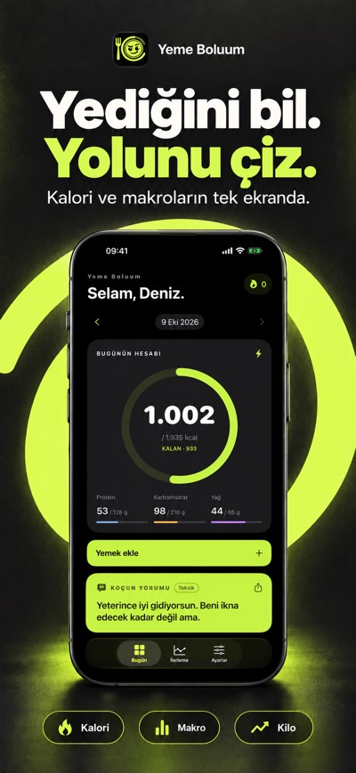
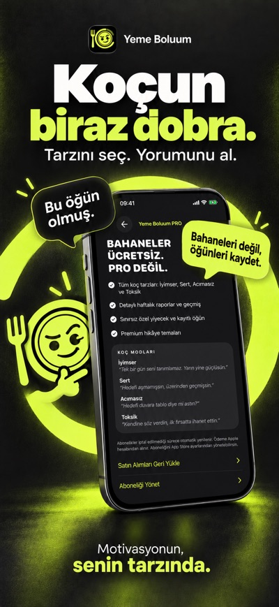
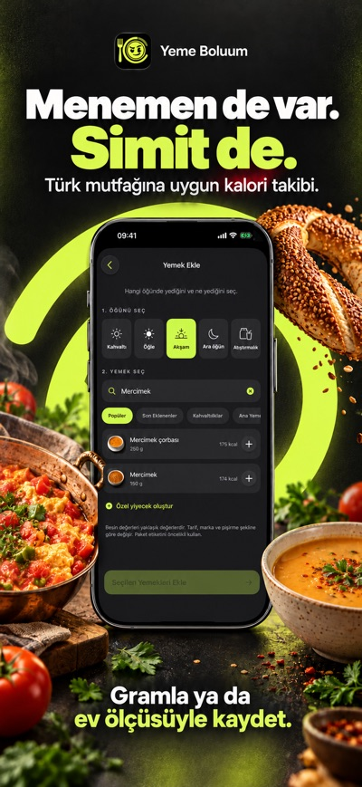
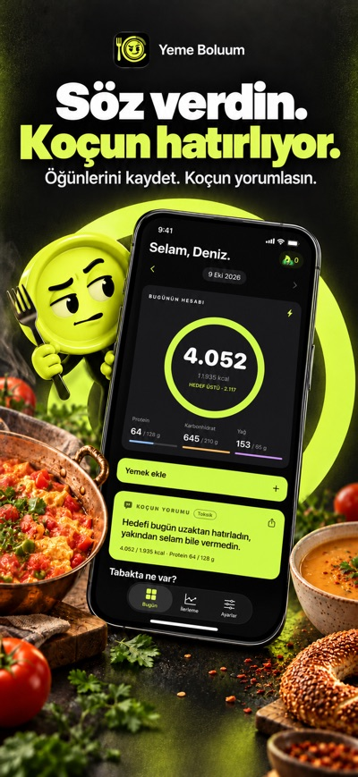
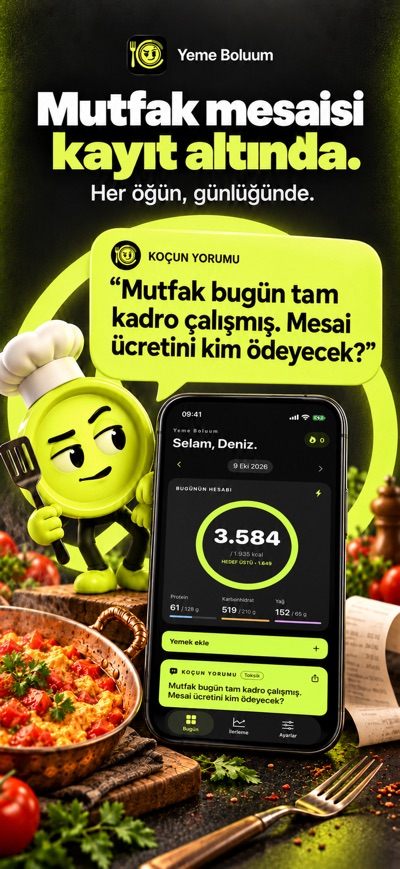
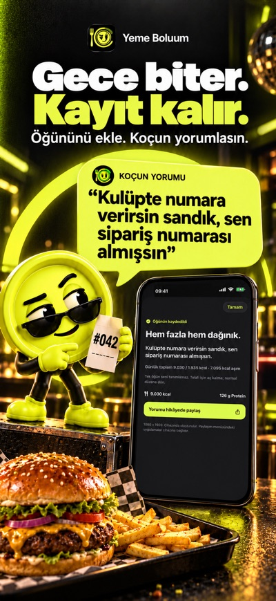
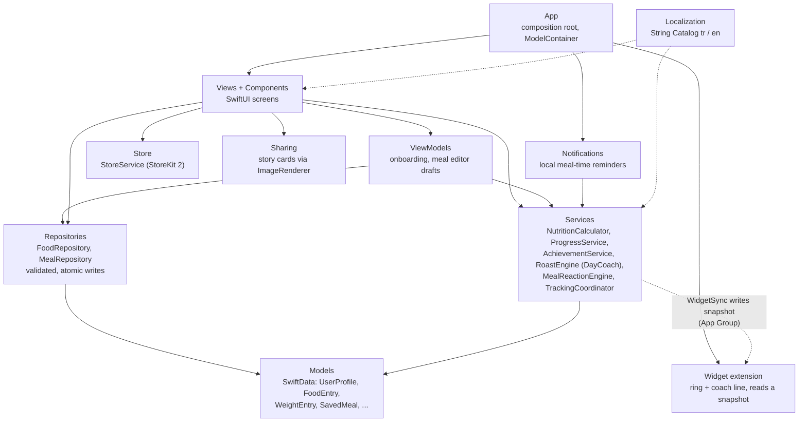
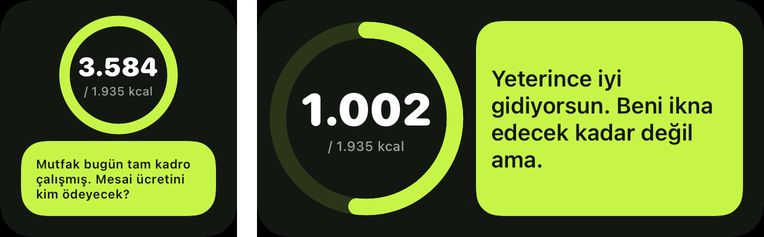

# Yeme Boluum / Calorude

[](https://apps.apple.com/tr/app/id6817766716)   

A calorie and macro tracker whose coach answers with a sense of humour. You log a meal, and a coach reads the day's real totals back to you in one of five styles, from Optimistic to Toxic. Live on the App Store: **[Yeme Boluum](https://apps.apple.com/tr/app/id6817766716)**.

Branding: Turkish-language devices see **Yeme Boluum**, everyone else sees **Calorude** (in-app `brand.name` and the localized `CFBundleDisplayName`; the development region is English so unmatched languages fall back to Calorude). Set the same split as localized App Store names in App Store Connect. iPhone only, portrait, version 1.0.1.

Native iOS 17+ nutrition tracker. SwiftUI, SwiftData, Swift Charts, StoreKit 2, UserNotifications and ImageRenderer. No backend, account, analytics, AI or third-party dependencies.

<p>
  
  
  
  
</p>
<p>
  
  
  
  
</p>

Open `Calorude.xcodeproj`, select the **Calorude** scheme and an iPhone simulator, then Run. Xcode 26.2 was used for development. The checked-in project works without XcodeGen; after adding files to `project.yml`, regenerate with `xcodegen generate`.

## Architecture

Dependencies point one way. Views read the diary with `@Query` and hand every rule (targets, streaks, coach state, reminders) to a service, and every write to a repository. The services import only Foundation, so those rules are unit tested without any UI.



Data flow of one meal: the editor keeps a draft in `MealEditorViewModel`; Save in `FoodLogView` calls `MealRepository.commit`, which validates the draft and writes the entries with the day's target snapshot, so a later plan edit never rewrites history; `MealReactionEngine` then judges the meal against the whole day and the coach line is picked from the String Catalog by state, style and tags. `RootView` re-runs `TrackingCoordinator.rebuild` whenever the diary changes to refresh the derived daily summaries, and reschedules the reminders.
## Home screen widget

A small and a medium widget in the app's theme: a lime calorie ring and the coach's line for the day, nothing else.



The widget never opens the SwiftData store. After every diary change `WidgetSync` renders the ring numbers and the coach line (in the in-app language and style, Pro styles only for Pro users) into a small `WidgetSnapshot` in the shared App Group (`group.com.yemeboluum.app`) and asks WidgetKit to reload. The snapshot also carries the empty-day view, so at midnight the widget resets the ring and shows an empty-day line before the app runs again. Keeping the store where it is means no migration for existing users. The views live in `Shared/WidgetViews.swift` and are also compiled into the app so tests can render them to PNG.

## Implemented

- Onboarding is seven short screens: goal (lose weight, build muscle, gain weight, maintain), about you, body measurements, daily lifestyle, weekly workouts, a goal-specific habit question and an adult/safety confirmation. A 4.4-second "calculating" screen precedes the plan. There is no pace picker: the app chooses a healthy rate itself (loss about 0.5–0.75 % of body weight a week and never above 1 kg, gain 0.3 kg, muscle 0.2 kg) and still applies the calorie floors and the 20 % TDEE deficit cap, then shows the estimated weekly change and a target date. Mifflin–St Jeor BMR with an activity factor built from lifestyle plus workouts, conservative goal adjustment, energy-consistent macros (2 g/kg protein for muscle gain). Profile plan editing preserves historical entry targets.
- Turkish/English String Catalog, centralized AppBrand, device-language fallback and persistent in-app language switching. Dark-first and light appearances.
- Local SwiftData profile, food logs, favorites, custom foods, saved meals with cascading items, weigh-ins, daily summaries, streaks, achievement unlocks and preferences. CloudKit disabled explicitly. Error handling preserves existing stores rather than resetting them.
- Bundled searchable 108-entry dataset: 88 foods/meals and 20 drinks (generic estimates and sourced branded drinks), portions/custom amounts in grams or ml, dated meals, delete, favorites, custom food creation and multi-item reusable meals. The meal editor keeps sequential additions in a draft, shows meal totals, and commits them together with Save. Each dashboard meal has Edit for later additions, removals and portion changes; Cancel discards diary edits. Switching meal types preserves each draft. Free: 10 custom foods and 3 saved meals; existing records remain usable after PRO ends.
- The dashboard coach evaluates the selected day’s total calories and protein against daily targets, with time-of-day handling. It stays separate from the meal popup and displays the daily totals used.
- After a meal is saved, a coach popup judges that meal against the whole day: the food (balanced or not) and the fit (within target, tight, over) are separate questions, giving six states (good, big but it fits, balanced but squeezes the day, unbalanced within target, unbalanced and over, incomplete entry). The edited meal is counted once in the day total; the same meal reads differently with 0, 600 or 1,000 kcal already logged. A short quote leads and the numbers sit in a secondary line; both go to a free 1080×1920 Story PNG via the native share sheet. Composition is a lightweight heuristic, not a clinical quality score or a claim about attractiveness.
- Dashboard with calorie ring, macros, dated diary and a context-aware coach comment that reads the selected day's total (seven states: empty, low, steady, on target, over, far over, low protein). The pick is stable across redraws and rotates when the totals change.
- One coach, five styles ("Koç Tarzı"): optimistic, normal (free), savage, unhinged, toxic (the old "nuclear" value is still read from saved profiles). Every state × style has eight different lines in both languages (day and meal comments), plus context lines (rice and chicken, sugary drink, no protein, no vegetables, third dessert, repeated treats, repeated overshoot, evening and more) that are only eligible when the saved data supports the claim. The coach never swears. Lines quote real numbers through placeholders, recent lines are not repeated, and `Scripts/validate_resources.py` enforces length, placeholders, uniqueness per state, no profanity, no hard-coded numbers, and the no-body/no-worth/no-fasting boundary.
- Weight and calorie charts, ranges, weekly averages, protein history, adherence, current/best streaks and milestones. Averages explicitly use logged days, while success counts use the seven-day window. Weight trend compares two seven-day averages.
- Opt-in local meal-time reminders in the selected coach mode (only Normal is free): breakfast 09:30, lunch 13:30, dinner 20:00, at most three a day and daytime only. A meal already logged sends nothing; a day with no entries gets "nothing logged" messages at noon and in the evening. Today is planned from the real diary and the next two days assume an empty one; schedules are rebuilt on app activity and on diary, mode, language and entitlement changes. 75 bilingual messages (5 kinds × 5 modes × 3 variants). iOS does not run a continuously updating nutrition engine in the background.
- Four local 1080×1920 PNG story templates (daily, weekly, roast, streak), four themes, native activity sheet. Free exports retain full resolution. Sharing targets depend on installed apps and their extensions.
- StoreKit product loading, actual `displayPrice`, computed annual savings and monthly equivalent, purchase/cancel/pending/unverified states, restore, verified entitlements, expiration refresh and transaction updates. No local premium override.
- App icon, privacy manifest, localized in-app privacy/terms/calculation notes, VoiceOver labels, Dynamic Type and reduced-motion-aware dashboard animation.

## Structure

`App` assembles dependencies and persistent storage. `Models` defines local records and value types. `Services` owns nutrition, progress, achievements, coach selection and derived-record rebuilding. `Repositories` loads the food resource and validates logging. `ViewModels` manages onboarding inputs. `Views` and `Components` render the interface. `Store`, `Notifications`, `Sharing`, `Localization` and `Resources` isolate platform integrations and content.

Food source URLs and recipe estimates are documented in `Documentation/FOOD_SOURCES.md`. Preparation selection lives in the portion editor, with separate per-100 nutrient profiles and saved preparation snapshots. Relevant foods offer named portions with explicit approximate grams/ml equivalents. Raw/dry variants use gram input when cooked household measures would be misleading. Drink units persist through diary edits and saved meals; custom foods support a grams/ml selector. Legacy internal `grams` / `Per100g` field names are retained for compatibility, with the stored unit defining the amount and denominator.

Persisted nutrition snapshots are intentional: changing a bundled food later does not rewrite a user's old diary. Daily summaries, achievement unlocks and streak state are rebuilt from the diary. Streaks allow ±10% and don't break an ongoing streak because today is still incomplete.

## Build and test

```sh
xcodebuild -project Calorude.xcodeproj -scheme Calorude \
  -destination 'platform=iOS Simulator,name=iPhone 16e' -only-testing:CalorudeTests test
python3 Scripts/validate_resources.py
```

`CalorudeTests` runs in about three seconds (59 tests; two screenshot renderers skip unless `SHOTS_DIR` is set). `CalorudeUITests` drives onboarding and the meal editor end to end and also produces the App Store screenshots.

The tests cover BMR/TDEE/macros, the success window, day/week aggregation with historical target snapshots, achievements and the weight trend (`ProgressTests`), quantities, target limits, goal validation, streak tolerance and gaps, weekly averages, time-aware coach rules, bilingual libraries, SwiftData save/cascade, verified entitlement policy and actual StoreKit test purchases/expiration. Story tests render all templates in both languages and attach the PNGs. UI tests complete onboarding, add rice/chicken/yogurt in one meal session, save, reopen, edit portions, remove a food, cancel an edit, open progress, switch languages and change appearance. Meal repository tests cover atomic validation, historical nutrition/target preservation, derived-summary updates, other meal/date isolation and stale-edit rejection. UI tests use an isolated in-memory store only in Debug; they never erase a normal installation's data.

`Development.storekit` is a **local StoreKit test configuration**, not live App Store pricing. The scheme uses it for local Run. The default test storefront is Türkiye (TUR), locale tr_TR, using the brief’s Turkish planning values: monthly 79 and yearly 599 TRY. When testing another region, change both storefront and numeric test prices in Xcode’s StoreKit editor; the local file does not simulate App Store Connect regional price schedules. UI prices always come from StoreKit products.

## Releasing

Version 1.0.1 is live. A release is: bump `MARKETING_VERSION` / `CURRENT_PROJECT_VERSION` in `project.yml` (then `xcodegen generate`), `xcodebuild archive -configuration Release`, then `xcodebuild -exportArchive -exportOptionsPlist ExportOptions.plist` (its `destination: upload` sends the build to App Store Connect). Screenshots, subtitle and keywords only change with a new version. The debug-only `--shots`, `--shots-pro` and `--uitesting` launch arguments are compiled out of Release builds.

An actual App Store release still needs the owner's Apple developer team/signing, App Store Connect application and approved IAP records, App Store metadata and public support/privacy URLs. Disable the local StoreKit configuration when testing against App Store Connect. Test real sandbox restoration, refunds, billing retry/grace and interrupted/pending purchases on physical devices before submission.

Product identifiers:

| Product | Type | Identifier |
|---|---|---|
| Monthly PRO | Auto-renewable | `com.yemeboluum.pro.monthly` |
| Yearly PRO | Auto-renewable, same group/level | `com.yemeboluum.pro.yearly` |

Configure regional prices in App Store Connect: Türkiye 79 / 599 TRY; US and most regions 3.49 / 24.99 USD or EUR (monthly/yearly).

The bundled food values are explicitly estimates, not a licensed or clinically validated composition database. Validate recipes/serving weights and the calculation policy with a nutrition professional before a public health-focused launch. The app excludes minors/pregnancy/breastfeeding/eating-disorder treatment from its automatic onboarding plan. Its calorie floors are product guardrails, not personal safety guarantees.

Calculation references: [Mifflin et al. (1990)](https://ajcn.nutrition.org/article/S0002-9165%2823%2916698-6/fulltext) and [CDC gradual weight-management guidance](https://www.cdc.gov/healthy-weight-growth/losing-weight/index.html). Platform references: [StoreKit test sessions](https://developer.apple.com/documentation/StoreKitTest/SKTestSession) and [current entitlements](https://developer.apple.com/documentation/storekit/transaction/currententitlements).

The current version has no widgets or Apple Health integration; these were marked as future features in the brief.
